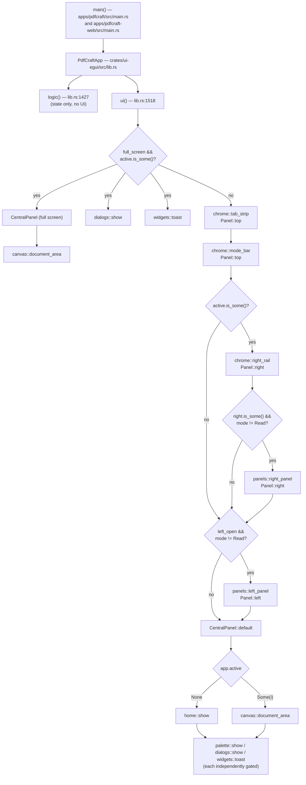
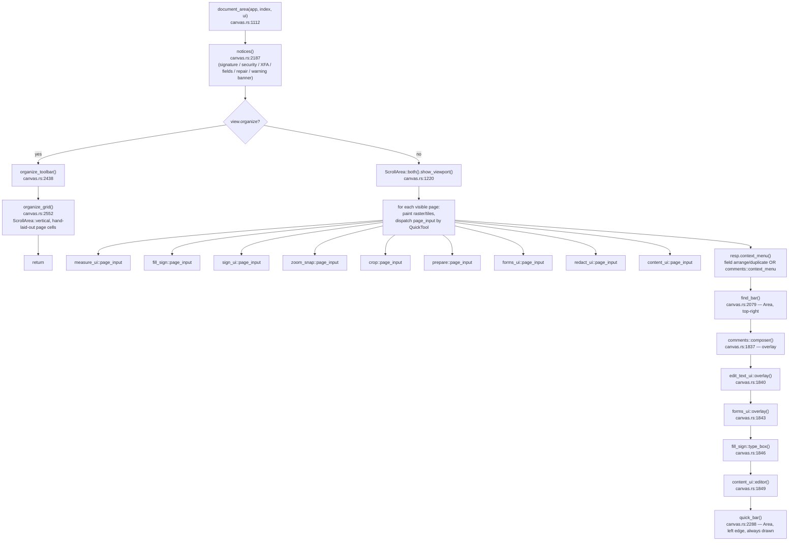

# PdfCraft — egui/eframe GUI component hierarchy

Reconstructed from source only (no application code was modified). PdfCraft is an
**immediate-mode** egui/eframe app: there is no persistent widget tree. Every frame,
`PdfCraftApp::ui()` re-runs the same Rust function calls and egui re-derives layout from
scratch. The "hierarchy" below is therefore a **call tree of UI-constructing functions**,
annotated with the egui containers each one opens and the conditions that gate each branch —
not a retained scene graph.

## 1. Entry points

| Binary | File | What it does |
|---|---|---|
| Desktop app | `apps/pdfcraft/src/main.rs:73` (`fn main`) | Parses CLI flags, builds `eframe::NativeOptions`/`ViewportBuilder`, calls `eframe::run_native` with a closure that constructs `PdfCraftApp::new()` (apps/pdfcraft/src/main.rs:152-191). |
| Web (WASM) app | `apps/pdfcraft-web/src/main.rs:7` (`fn main`, `cfg(target_arch = "wasm32")`) | Same `PdfCraftApp`, started via `eframe::WebRunner` against a `<canvas id="pdfcraft">` (line 15), with `?file=` URL fetch support. |

Both binaries are thin shells around one shared struct, **`PdfCraftApp`**, defined in
`crates/ui-egui/src/lib.rs:322-512`. All GUI-construction code lives in the `pdfcraft-ui-egui`
crate (`crates/ui-egui/src/`); the binaries contribute no UI code of their own beyond passing
through window/platform setup.

## 2. `eframe::App` implementation

`impl eframe::App for PdfCraftApp` — `crates/ui-egui/src/lib.rs:1422-1572`.

eframe splits a frame into two callbacks; **only the second builds UI**:

- **`logic(&mut self, ctx, _frame)`** (lib.rs:1427-1516) — no UI calls. Installs fonts/theme once,
  drains async inboxes (dropped files, web fetch results, OS Apple events), ticks the control
  channel, autosave, shortcuts, pending edits, export/OCR/action job polling, and pulls finished
  page renders into GPU textures. This runs before egui's UI pass and is **not part of the visual
  tree** — listed here only because it's the other half of the `App` impl.
- **`ui(&mut self, ui, _frame)`** (lib.rs:1518-1571) — the actual GUI tree, detailed below.
- `save()` (lib.rs:1423) serializes persisted state (`persist()`, lib.rs:1054) to `eframe::Storage`.
- `shortcuts()` (lib.rs:1352) — keyboard routing, not UI construction.

## 3. Top-level `ui()` tree

Source: `crates/ui-egui/src/lib.rs:1518-1571`.

Two mutually exclusive top-level branches:

### 3a. Full-screen reading (`self.full_screen && self.active.is_some()`) — lib.rs:1535-1550
```
CentralPanel::default()                                   (egui::CentralPanel, frame-filled)
└─ canvas::document_area(app, active_index, ui)            [only if an active tab exists]
dialogs::show(app, ctx)                                    (overlay, Dialog::* modal)
widgets::toast(app, ctx)                                   (overlay, Area)
```
Nothing else is drawn — Esc or ⌘L (`set_full_screen`, lib.rs:857) leaves this mode.

### 3b. Normal workspace — lib.rs:1551-1570
```
chrome::tab_strip(app, ui)            Panel::top("tab_strip")      — always
chrome::mode_bar(app, ui)             Panel::top("mode_bar")       — always
if app.active.is_some():
  chrome::right_rail(app, ui)         Panel::right("rail")
  if app.right.is_some() && app.mode != Mode::Read:
    panels::right_panel(app, ui)      Panel::right("right_panel")
if app.left_open && app.mode != Mode::Read:
  panels::left_panel(app, ui)         Panel::left("tool_panel")
CentralPanel::default()               egui::CentralPanel
└─ match app.active:
     None    => home::show(app, ui)
     Some(i) => canvas::document_area(app, i, ui)
palette::show(app, &ctx)              overlay Area, gated on app.palette_open
dialogs::show(app, &ctx)              overlay Modal, gated on app.dialog.is_some()
widgets::toast(app, &ctx)             overlay Area, gated on app.toast.is_some()
```
`egui::Panel::{top,left,right}` are egui's dockable-panel primitives (distinct from the older
`TopBottomPanel`/`SidePanel` aliases but functionally the same role). Panel show-order in code
is top → right rail → right panel → left panel → center; egui's layout engine reconciles the
actual screen geometry from each panel's reserved space regardless of call order.

**Conditional/dynamic gates**, all re-evaluated every frame:
- `full_screen` — hides all chrome.
- `active.is_some()` — the right rail and right panel only exist once a document tab is open.
- `mode == Mode::Read` — suppresses the left tool panel and right panel (Acrobat's "Read" mode).
- `left_open` (bool) and `left: LeftPanel` (`AllTools` | `Tool(&'static str)`) — left panel content.
- `right: Option<RightPanel>` — which (if any) right panel is shown; 10 variants (lib.rs:127-142).
- `palette_open`, `dialog: Option<Dialog>` (43 variants, lib.rs:180-258), `toast: Option<(String,f64)>`.

## 4. Chrome containers

Source: `crates/ui-egui/src/chrome.rs`.

### `tab_strip` — chrome.rs:9-64
`egui::Panel::top("tab_strip").exact_size(38.0)` → `ui.horizontal_centered(...)`:
- Home button (`icons::button`, "house") — clears `app.active`.
- One `tab()` (chrome.rs:80-121) per `app.views[i]` — custom-painted (not `egui::Button`): rect +
  manual paint of icon/label/close-x/dirty-dot, built with `ui.allocate_exact_size` +
  `ui.interact`. Repeated per open document (`Vec<DocView>`).
- "Open" ghost button → `app.open_dialog()`.
- Right-aligned (`Layout::right_to_left`): theme toggle (`icons::button` + `egui::Popup::menu` →
  `theme_menu`, chrome.rs:67-78), shortcuts help button, Discord link button.

### `mode_bar` — chrome.rs:123-163
`egui::Panel::top("mode_bar").exact_size(48.0)` → `ui.horizontal_centered(...)`:
- `main_menu(app, ui)` (chrome.rs:165-244): ghost button → `egui::Popup::menu` containing
  `ui.menu_button` submenus — File / Edit / Pages (chrome.rs:170-172, each → `commands::
  registry_menu`), **View** (chrome.rs:173-221, detailed below), Help (chrome.rs:242, →
  `registry_menu`). `commands::registry_menu(app, ui, "<name>")` (commands.rs:545) iterates
  `pdfcraft_engine::commands::menu(menu)` and emits one `egui::Button` per registered command
  spec — it is reused across File/Edit/Pages/View/Help and nowhere else.
  The **View** submenu: when a document is active (`if let Some(i) = app.active`, chrome.rs:
  174-220) it inlines a Zoom section, page-navigation buttons (gated on `view.back`/`forward`
  being non-empty), and a nested `page_display_menu(ui, &app.views[i])` (chrome.rs:216) — the
  *same* helper is reused verbatim from `right_rail`'s page-display popup (chrome.rs:306, see
  below). Unconditionally, View also calls `registry_menu(app, ui, "View")` (chrome.rs:221) and
  nests two further submenus: "Display theme" → `theme_menu` (chrome.rs:222 — the *same*
  function also opened from `tab_strip`'s theme-toggle popup, chrome.rs:53) and "Side panels"
  (chrome.rs:223-240 — 10 `ui.radio` items, one per `RightPanel` variant, writing `app.right`).
- A tab row of 5 `widgets::mode_tab` buttons: AllTools / Read / Edit / Convert / Sign
  (`Mode` enum, lib.rs:97-104) → `app.select_mode(mode)`.
- Right-aligned, enabled only when `app.active.is_some()`: print/save/properties icon buttons,
  then `widgets::search_box` → opens the command palette.

### `right_rail` — chrome.rs:246-352
`egui::Panel::right("rail").exact_size(48.0)`, early-returns (`let Some((index,id)) =
app.active_ids() else { return }`, chrome.rs:248) if no active document. Vertical stack of
`rail_button` closures, one per `RightPanel` variant (Comments/Bookmarks/Pages/Fields/Layers/
Attachments/Signatures, plus Accessibility only `if has_check`), each an `icons::button` with a
presence-dot overlay driven by per-kind `has_*` flags read from `doc.info`. Below, a
`Layout::bottom_up` cluster: zoom out/in, a page-display icon whose click opens
`egui::Popup::menu(&resp).show(|ui| rail_view_menu(ui, view))` (chrome.rs:303-308), rotate, fit
toggle (icon swaps with `view.fit`), zoom-percent label, next/prev page chevrons, page-count
label, and a page-number `egui::TextEdit::singleline` in a styled `egui::Frame` (chrome.rs:
327-339), committed on Enter to `DocView::go_to_typed` (chrome.rs:340-346).

`rail_view_menu(ui, view)` (chrome.rs:377-408, called only here) is a plain `ui.button` list
(no container of its own) that itself calls `page_display_menu` again (chrome.rs:397) — so
`page_display_menu` has two call sites (here and `main_menu`'s View submenu) while
`rail_view_menu` has exactly one.

## 5. Left panel (tool catalogue)

Source: `crates/ui-egui/src/panels.rs:17-375`.

`left_panel` → `egui::Panel::left("tool_panel").exact_size(272.0)` → matches `app.left`:

```
LeftPanel::AllTools  → all_tools(app, ui, t)        panels.rs:55
LeftPanel::Tool(id)  → tool_detail(app, ui, t, g)   panels.rs:112   (g = catalog::group(id))
```

- **`all_tools`** (panels.rs:55-73): `panel_header` + `egui::ScrollArea::vertical()` listing
  `tool_row` (panels.rs:75) entries from `pdfcraft_engine::catalog::TOOL_GROUPS` — a data-driven
  list (collapsed to 14 rows unless `app.all_tools_expanded`), not one widget per hand-written
  tool.
- **`tool_detail`** (panels.rs:112-233): `panel_header` (back/close), then one of several
  special-cased bodies by `g.id`:
  - `"measure"` → `measure_ui::panel` (early return)
  - `"stamp"` → `stamp_palette` (panels.rs:237, early return)
  - `"form"` → an inline Preview/Edit toggle row, then falls through
  - `"edit"` → `format_section` (panels.rs:301) prepended above the list
  - otherwise (and after the above prologues): `egui::ScrollArea::vertical()` over
    `g.sections[*].items[*]` (the catalogue), one custom-painted row per command, plus (for
    `"fill_sign"`) `fill_sign::signature_entries`, plus (for `"redact"`) an Acrobat-style
    Clear-all/Redact-all footer row.

This whole panel is **generated from `pdfcraft_engine::catalog::TOOL_GROUPS`** — the UI code
itself has no per-tool widget definitions beyond the handful of `g.id` special cases above.

## 6. Right panel

Source: `crates/ui-egui/src/panels.rs:384-647`.

One `egui::Panel::right("right_panel")` (resizable, 260–520px), early-returns without an active
doc/panel. Header row (title, count badge, panel-specific buttons), then **one**
`egui::ScrollArea::vertical()` whose body is a `match panel { … }` over `RightPanel`:

| `RightPanel` variant | Content function | Notes |
|---|---|---|
| `Comments` | `comments_panel::show` (panels.rs:491) | thread list, search, filter header via `comments_panel::header_controls` |
| `Bookmarks` | `outline_item` (panels.rs:686-786), recursive, one call per `doc.info.outline` root | tree rows with expand/rename/drag, `OutlineCtx` carries shared mutable intent |
| `Pages` | `pages` (panels.rs:790) | thumbnail grid/list, multi-select |
| `Fields` | `fields` (panels.rs:846) | form-field list, ordered specially while Prepare-a-form is open |
| `Layers` | inline (panels.rs:513-536) | one checkbox-row per OCG layer, not delegated to a submodule |
| `Signatures` | `sign_ui::panel` (panels.rs:538) | |
| `Accessibility` | `a11y_ui::panel` (panels.rs:541) | only reachable once a check has run |
| `Search` | `search_ui::panel` (panels.rs:543) | |
| `Compare` | `compare_ui::panel` (panels.rs:544) | |
| `Attachments` | inline (panels.rs:545-582) | one `Frame` row per attachment, save/open actions |

Each delegate returns an enum of **intents** (`Nav`, `PanelAction`, `Edit`, command id, …);
`right_panel` applies them after the `Panel::show` closure returns (panels.rs:586-647) — state
mutation is kept out of the immediate-mode drawing pass.

The recursive `outline_item(ui, t, info, item, path, siblings, cx)` (panels.rs:686-786) is the
clearest example in the codebase of egui's immediate-mode discipline: there is **no persisted
tree** in `PdfCraftApp`. Expand/collapse state is rebuilt and re-walked every frame, and "which
nodes are open" lives in **egui's own per-widget temp memory** (`ui.data_mut`, keyed by
`ui.id().with(("outline", path))`), not in an app-owned field — recursion depth is simply
`path.len()`, one explicit call per child (panels.rs:779-785).

## 7. Home screen

Source: `crates/ui-egui/src/home.rs` (148 lines, read in full).

`home::show(app, ui)` (home.rs:11) — single function, no further delegation:

```
egui::ScrollArea::vertical()
└─ egui::Frame (page margins)
   ├─ "Welcome to PdfCraft" heading + subtitle (ui.label ×2)
   ├─ egui::Frame (card) → ui.horizontal: ArtCraft mark + community blurb
   │    └─ widgets::community_links(ui)                 (Discord/GitHub links)
   ├─ egui::Frame (card) "Recommended tools"
   │    └─ ui.horizontal_wrapped: one custom-painted tile per id in RECOMMENDED
   │        (organize/comment/form/edit/protect, from catalog::group) + one "Open file" tile
   ├─ "Recent" section: one custom-painted row per app.recent (RecentFile), or an empty-state label
   └─ widgets::section_title "Privacy" + static privacy blurb
```
All tiles/rows are hand-painted (`ui.painter()` + `ui.allocate_exact_size` + `Sense::click()`),
not `egui::Button`/`egui::Grid` — consistent with the rest of the app's custom-widget style.
State dependencies: `app.recent: Vec<RecentFile>`, `app.left`/`app.left_open` (tile clicks route
into the left tool panel), `app.views` (to re-activate an already-open recent file).

## 8. Document area — representative screen, traced in detail

Source: `crates/ui-egui/src/canvas.rs`, function `document_area` (canvas.rs:1112-1987), called
from the `CentralPanel` in both the normal (§3b) and full-screen (§3a) branches. This is the
PDF-viewing/editing surface and the most complex single screen in the app — a mostly
hand-painted canvas rather than a tree of standard egui widgets.

```
document_area(app, index, ui)
├─ notices(view, doc, …) ─────────────────────── canvas.rs:2187   egui::Frame banner, conditional
│    (signature banner | security | XFA | form-fields | repaired | warning — first match wins)
│
├─ if view.organize:  ── Organize Pages grid (early return) ──────────────────────────
│    organize_toolbar(view, info, …)            canvas.rs:2438   ui.horizontal toolbar
│    organize_grid(view, info, pool, …)         canvas.rs:2552
│      └─ egui::ScrollArea::vertical()
│           └─ custom grid of page cells (manually laid out Rects, not egui::Grid):
│              drag-to-reorder, multi-select, thumbnail paint per cell
│    (return — nothing below runs)
│
├─ else: normal page view ─────────────────────────────────────────────────────────────
│    egui::ScrollArea::both().show_viewport(ui, |ui, viewport| { … })   canvas.rs:1220-1785
│      for each visible page (per view.layout: Single | Continuous | TwoUp):
│        • paint page raster / tiled textures, loading/placeholder/error states
│        • per-QuickTool page-level input dispatch, one call per active tool:
│            measure_ui::page_input      (QuickTool::Measure)      canvas.rs:1441
│            (stamp placement, inline)   (QuickTool::Stamp/CustomStamp) canvas.rs:1446-1489
│            fill_sign::page_input       (QuickTool::Fill)          canvas.rs:1493
│            sign_ui::page_input         (QuickTool::SignArea)      canvas.rs:1501
│            zoom_snap::page_input       (QuickTool::MarqueeZoom|Snapshot) canvas.rs:1504
│            crop::page_input            (QuickTool::Crop)          canvas.rs:1506
│            prepare::page_input         (preparing a form)         canvas.rs:1515
│            forms_ui::page_input        (QuickTool::Select, filling a form) canvas.rs:1520
│            redact_ui::page_input       (QuickTool::Redact | area-highlight) canvas.rs:1530
│            content_ui::page_input      (editing_content | AddText)  canvas.rs:1533
│            comments overlay hit-testing via comments::PageCx         canvas.rs:1439
│        • resp.context_menu(...)         right-click menu: Prepare-field arrange/duplicate/
│                                          delete, else comments::context_menu  canvas.rs:1733-1783
│
│    (floating overlays drawn after the ScrollArea, still inside document_area)
│    find_bar(view, …)                    canvas.rs:2079   egui::Area, top-right, conditional on view.find
│    comments::composer(ctx, view, …)     canvas.rs:1837   overlay editor for a new/edited comment
│    edit_text_ui::overlay(ctx, view, …)  canvas.rs:1840   in-place text-block editor
│    forms_ui::overlay(ctx, view, …)      canvas.rs:1843   floating widgets for non-paintable field types
│    fill_sign::type_box(ctx, view, …)    canvas.rs:1846   "type your signature" box
│    content_ui::editor(ctx, view, …)     canvas.rs:1849   added-text inline editor
│
└─ quick_bar(app, area, ui) ──────────────────── canvas.rs:2288   egui::Area, left edge, always
     vertical icon stack (Select/Hand/Comment groups/Measure/Crop/Fill/Field/Redact/AddText/
     EditText/Stamp/Link/SignArea/MarqueeZoom/Snapshot) → sets app.quick_tool
```

Key points on accuracy:
- The `ScrollArea::both().show_viewport` closure does **not** build child `egui::Ui` widgets per
  page; it paints directly with `ui.painter()` against manually computed `Rect`s from
  `view.layout(info, content_w)` (canvas.rs:1181). Page "widgets" are hit-test regions
  (`ui.allocate_exact_size` + `Sense`), not retained UI nodes — consistent with egui's
  immediate-mode model.
- Tool dispatch is **mutually exclusive per frame** on `app.quick_tool: QuickTool` (16 variants,
  lib.rs:146-178), not a nested conditional widget tree — each page_input call early-returns if
  the tool doesn't match.
- `notices`, `find_bar`, `comments::composer`, and the four overlay/editor calls after the
  scroll area are **reused by every page layout and every QuickTool**; they are drawn once per
  `document_area` call, not per page.

### State dependencies
- `PdfCraftApp`: `quick_tool`, `left`/`left_open`, `right`, `dialog`, `comment_prefs`,
  `signature`/`initials`, `text_style`, `redact_prefs`, `custom_stamps`, `session: Session`
  (engine documents).
- `DocView` (canvas.rs:181-~310, one per open tab): `zoom`, `fit`, `layout`, `rotation`,
  `current`, `organize`, `find`, `comments`, `measure`, `forms`, `prepare`, `content`, `links`,
  `redact_drag`, `crop_drag`, `sign`, plus render caches (`pages`, `tiles`, `thumbs`, `texts`)
  that are populated asynchronously by `pdfcraft_engine`'s `RenderPool` and pulled in by
  `DocView::receive` (called from `PdfCraftApp::logic`, lib.rs:1511-1515, not from `ui()`).

## 9. Dialogs (modal layer)

Source: `crates/ui-egui/src/dialogs.rs`.

`dialogs::show(app, ctx)` (dialogs.rs:12-1500) first draws three always-checked,
independently-gated standalone modals, *outside* the `Dialog` enum entirely — each is its own
`egui::Modal::new(<its own Id>)`, gated on its own `Option` field, checked unconditionally every
frame before `app.dialog` is even consulted:
- `password(app, ctx)` (dialogs.rs:1458-1500) — `egui::Modal::new("password")`, gated on
  `app.password_prompt`; password `TextEdit`, Enter-to-submit, inline error text.
- `save_prompt(app, ctx)` (dialogs.rs:1349-1396) — `egui::Modal::new("save_prompt")`, gated on
  `app.close_request`; Save / Cancel / Don't Save buttons.
- `link_prompt(app, ctx)` (dialogs.rs:1401-1451) — `egui::Modal::new("link_prompt")`, gated on
  `app.pending_link` (a document's link/button/script asking to open a URL, #90/#91).
- `updates::dialog(app, ctx)` (defined in `updates.rs`, not opened in this pass) — presumably the
  same pattern for an "update available" notice; not individually verified.

It then returns early unless `app.dialog: Option<Dialog>` is set. The dialog body itself is
**one `egui::Modal::new(egui::Id::new("dialog")).show(ctx, |ui| { … })`** (dialogs.rs:64-80) — a
single container, width set per-variant (dialogs.rs:65-71) before a `match dialog { … }`
(dialogs.rs:80-1097, 43 arms, one per `Dialog` variant). Most arms build their own footer and `return` early from the
closure; the remaining arms fall through to a **shared** right-aligned OK/Cancel/Close footer
built once after the match (dialogs.rs:1098-1137) — so the footer itself is a reused component
with per-variant opt-out, not a per-dialog duplication.

| `Dialog` variant | Arm (dialogs.rs) | Delegate | Purpose |
|---|---|---|---|
| `CreateImages` | 81-86 | `create_ui::image_import_body` | DPI/resolution when importing images as a new PDF |
| `Properties(tab)` | 87-391 | inline; tabs Description/InitialView/Security/Fonts/Advanced, each an `egui::Grid` | Document Properties |
| `Split` | 392-458 | inline | Split document options |
| `ReplacePages` | 459-507 | inline | Replace a page range from another file |
| `RedactPages` | 508-516 | `redact_ui::pages_body` | Redact: choose pages |
| `RedactSearch` | 517-524 | `redact_ui::search_body` | Redact: find text and redact |
| `RedactProps` | 525-531 | `redact_ui::props_body` | Redact: appearance properties |
| `RedactApply` | 532-540 | `redact_ui::apply_body` | Redact: apply confirmation |
| `LinkProps` | 541-553 | `link_ui::body` | Link Properties editor |
| `Extract` | 554-577 | inline | Extract selected pages |
| `RotatePages` | 578-650 | inline | Rotate pages |
| `DuplicateField` | 651-681 | inline | Duplicate a form field onto pages |
| `Optimize` | 682-691 | `optimize_ui::body` (can redirect to `AuditSpace`) | PDF Optimizer |
| `CertificateViewer` | 692-710 | `sign_ui::cert_viewer` | View / trust / export a certificate |
| `AuditSpace` | 711-716 | `optimize_ui::audit_body` (redirects back to `Optimize`) | Audit space usage |
| `Sign` | 717-723 | `sign_ui::dialog` | Sign with a Digital ID / Certify |
| `SummarizeComments` | 724-749 | inline | Summarize Comments options |
| `Revert` | 750-769 | inline | Revert-to-saved confirmation |
| `Print` | 770-784 | `print_ui::body` | File ▸ Print |
| `RemoveHidden` | 785-792 | `redact_ui::hidden_body` | Remove Hidden Information |
| `Sanitize` | 793-800 | `redact_ui::sanitize_body` | Sanitize Document |
| `FieldProps` | 801-810 | `prepare::body` | Form field properties |
| `CommentProps` | 811-816 | `comment_props::body` | Comment Properties |
| `Signature` | 817-833 | `fill_sign::signature_pad` | Create signature/initials (drawing pad) |
| `AltText` | 834-839 | `a11y_ui::alt_body` | Add alternate text |
| `CreateStamp` | 840-845 | `stamps_ui::create_body` | Create a custom stamp |
| `Combine` | 846-855 | `combine_ui::body` | Combine files |
| `PdfA` | 856-859 | `standards_ui::body` | PDF/A standards check |
| `ActionWizard` | 860-864 | `actions_ui::body` | Action Wizard |
| `CompareFiles` | 865-870 | `compare_ui::body` | Choose the older file to compare |
| `JsConsole` | 871-875 | `js_ui::console_body` | JavaScript console |
| `DocumentJs` | 876-880 | `js_ui::document_js_body` | Document JavaScripts editor |
| `Preferences` | 881-884 | `js_ui::preferences_body` | Preferences |
| `RecognizeText` | 885-890 | `ocr_ui::body` | Scan & OCR: Recognize Text |
| `AccessibilityOptions` | 891-896 | `a11y_ui::options_body` | Accessibility Checker options |
| `Export(kind)` | 897-902 | `export_ui::body` | Export a PDF (image/text) |
| `Marks(kind)` | 903-909 | `marks_ui::body` | Header/Footer, Watermark, Background |
| `PageBoxes` | 910-915 | `pageboxes::body` | Set Page Boxes |
| `Protect` | 916-921 | `protect::body` | Protect Using Password |
| `NumberPages` | 922-986 | inline | Number pages (page labels) |
| `Recovery` | 987-1010 | inline | Recover unsaved documents from a crashed session |
| `Shortcuts` | 1011-1050 | inline (reads `pdfcraft_engine::commands::COMMANDS`) | Keyboard shortcuts reference |
| `About` | 1051-1096 | inline; sub-tabs About / `credits::contributors_ui` / `credits::models_ui` | About box |

After the `Modal::show` closure, `dialogs::show` applies whichever single-shot action flag the
body set (`export_now`, `marks_now`, `images_now`, …) — again, intent-then-apply, not mutation
inside the drawing closure.

## 10. Overlays: command palette and toast

- **`palette::show`** (palette.rs:33-165): gated on `app.palette_open`. `egui::Area` pinned
  top-center → `egui::Frame::popup` → a search `egui::TextEdit` + up to 12 scored hits
  (`pdfcraft_engine::commands::COMMANDS` and `catalog::TOOL_GROUPS`), each a custom-painted row.
  Enter or click runs a command (`app.run_command`) or opens a tool panel.
- **`widgets::toast`** (widgets.rs:84-107): gated on `app.toast.is_some()`, auto-dismisses after
  3.5s. `egui::Area` pinned bottom-center → `egui::Frame` → one `ui.label`.

Both are **non-modal floating `egui::Area`s**, layered via `egui::Order` above the panels but
not blocking input the way `egui::Modal` does.

## 11. Mermaid — top-level application layout



## 12. Mermaid — `document_area` in detail (representative screen)



## 13. State-dependency summary

| Container | Key `PdfCraftApp` fields | Key other state |
|---|---|---|
| `tab_strip` | `views: Vec<DocView>`, `active`, `theme_preference` | `session.get(id).display_name()/.dirty` |
| `mode_bar` | `mode`, `active` | `commands::menu()`, `catalog` |
| `right_rail` | `active`, `right` | `DocView::{zoom,fit,layout,current,page_input}` |
| `left_panel` | `left`, `left_open`, `all_tools_expanded`, `quick_tool`, `form_preview`, `text_style` | `catalog::TOOL_GROUPS` |
| `right_panel` | `right`, `comment_prefs`, `sig_expanded`, `a11y`, `compare`, `bookmark_rename` | `DocView::{comments,selected,current}`, `doc.info.*` |
| `home::show` | `recent`, `left`/`left_open`, `views` | `catalog::group(id)` |
| `document_area` | `quick_tool`, `dialog`, `palette_open`, `signature`/`initials`, `comment_prefs`, `redact_prefs`, `custom_stamps`, `text_style` | full `DocView` (see §8), `pdfcraft_engine::Document` |
| `dialogs::show` | `dialog`, plus one `*_draft` struct per dialog family (`split_draft`, `extract_draft`, `rotate_draft`, `sign_draft`, `export_draft`, `marks_draft`, `number_draft`, `protect_draft`, `boxes_draft`, `redact_*`, `optimize_draft`, `combine_draft`, `stamp_draft`, …) | — |
| `palette::show` | `palette_open`, `palette_query` | `pdfcraft_engine::commands::COMMANDS`, `catalog::TOOL_GROUPS` |
| `widgets::toast` | `toast: Option<(String, f64)>` | — |

## 14. Reused helper functions (explicit cross-reference)

- `icons::button` / `icons::paint` / `icons::image` (icons.rs:25-45) — the leaf icon-button
  primitive used by nearly every container above (tab strip, mode bar, rail, panels, quick bar,
  dialogs). This is the closest thing to a shared "widget component" in the app; it is not an
  `egui::Button`, it's a custom painter-based control.
- `widgets::{mode_tab, pill_button, ghost_button, search_box, menu_item, section_title}`
  (widgets.rs:9-80) — shared small controls used across mode_bar, panels, dialogs, home.
- `theme::Tokens::get(ctx)` — fetched at the top of almost every function above; supplies the
  resolved color/spacing tokens for the current light/dark theme. Not a UI container, but a
  near-universal dependency.
- `commands::registry_menu` (commands.rs:545) — used by all 5 top-level menus in `main_menu` and
  nowhere else; a genuine single-call-site-family helper despite looking generic.
- `chrome::theme_menu` (chrome.rs:67-78) — a menu-body helper with no container of its own,
  rendered inside two different popups: `tab_strip`'s theme-toggle `egui::Popup::menu`
  (chrome.rs:53) and `main_menu`'s "Display theme" submenu (chrome.rs:222).
- `chrome::page_display_menu` (chrome.rs:356-373) — likewise reused from two call sites:
  `main_menu`'s View submenu (chrome.rs:216) and `right_rail`'s `rail_view_menu` (chrome.rs:397).
- `page_input` family (measure_ui, fill_sign, sign_ui, zoom_snap, crop, prepare, forms_ui,
  redact_ui, content_ui) — each called exactly once, from `document_area`'s per-page loop, under
  a different `QuickTool`/mode condition; they are not interchangeable even though they share a
  naming convention and signature shape.
- `comments::context_menu`, `comments::composer`, `comments::keys`, `comments::CanvasAction` —
  reused across both the document canvas and (for counts/threads) the Comments right panel via
  `comments_panel.rs`, which is a separate module from `comments.rs`.

## 15. Not traced further (deliberately out of scope / uncertain)

- **Dialog body internals**: the ~30 `*_body`/`body` functions listed in §9 were identified by
  signature and call site but not individually opened; their internal widget composition
  (likely `ui.horizontal`/`ui.vertical`/`egui::Grid`/`ScrollArea` mixes similar to the panels
  traced in depth) is not enumerated per-dialog.
- **`updates::dialog`** (called at dialogs.rs:16, defined in `updates.rs`) — confirmed to run
  before the main `Modal`, gated on its own state, but its internal body was not opened; by
  convention with its three siblings it is presumably also an `egui::Modal`. (`password`,
  `save_prompt`, and `link_prompt` — dialogs.rs:1458, 1349, 1401 — were individually confirmed as
  their own `egui::Modal::new(<id>)` instances; see §9.)
- **`comments_panel.rs`, `search_ui.rs`, `compare_ui.rs`, `a11y_ui.rs`, `sign_ui.rs` (`panel`
  variants)** — confirmed as the right-panel delegates (§6) but their internal layout was not
  traced line-by-line.
- **`prepare.rs`, `forms_ui.rs`, `content_ui.rs`, `edit_text_ui.rs`, `measure_ui.rs`,
  `fill_sign.rs`, `crop.rs`, `redact_ui.rs`, `link_ui.rs`, `zoom_snap.rs`** — their `page_input`
  entry points and call sites are documented (§8), but the on-canvas widgets/overlays they paint
  (drag handles, field chrome, measurement labels, etc.) were not traced in detail.
- **`control.rs`** (the opt-in automation/UI-control channel, `pdfcraft-cli ui …`) is
  deliberately excluded: it drives the same `PdfCraftApp` state as a human would, but is not
  itself part of the rendered GUI tree.
- **`i18n`, `theme`, `bidi`, `icons`, `icon_data`, `system_fonts`, `autoscroll`, `wheel_pager`,
  `zoom_snap` (geometry helpers), `pageboxes` (data only)** are support/leaf modules referenced
  throughout but are not containers in their own right.
- egui's own internal layout algorithm (how `Panel`/`CentralPanel` negotiate shared space,
  `ScrollArea` virtualization) is framework behavior, not application code, and is summarized
  rather than re-derived.
- Kittest-based control-channel UI tests (`crates/ui-egui/tests/control.rs`, per
  `CLAUDE.md`) were not inspected; they would be the natural place to cross-check this hierarchy
  against automated assertions, but doing so was out of scope for a static trace.

## 16. Files examined (evidence)

Read in full or to the depth cited above:
- `apps/pdfcraft/src/main.rs` (full, 380 lines)
- `apps/pdfcraft-web/src/main.rs` (full, 86 lines)
- `crates/ui-egui/src/lib.rs` (full, 1572 lines) — `PdfCraftApp` struct, `Mode`/`LeftPanel`/
  `RightPanel`/`QuickTool`/`Dialog` enums, `eframe::App` impl, `set_option`
- `crates/ui-egui/src/chrome.rs` (full, 408 lines) — tab strip, mode bar, main menu, right rail
- `crates/ui-egui/src/panels.rs` (full, 935 lines) — left tool panel (`all_tools`, `tool_detail`,
  `stamp_palette`, `format_section`), right panel dispatch (`right_panel`, `outline_item`,
  `pages`, `fields`, `empty`)
- `crates/ui-egui/src/home.rs` (full, 148 lines)
- `crates/ui-egui/src/canvas.rs` (lines 1-410, 1112-1987, 2079-2325, 2552-2620 of 2795) —
  `DocView` struct, `document_area`, `notices`, `find_bar`, `quick_bar`, `organize_grid`
- `crates/ui-egui/src/dialogs.rs` (full, 1500 lines) — `show`, the standalone `password`/
  `save_prompt`/`link_prompt` modals, the main `Modal` container, the full `Dialog` match and its
  43 arms, the shared footer
- `crates/ui-egui/src/palette.rs` (full, 165 lines)
- `crates/ui-egui/src/widgets.rs` (function index + `toast`, 163 lines)
- `crates/ui-egui/src/icons.rs` (function index, confirms `button`/`paint`/`image` primitives)
- `crates/ui-egui/src/commands.rs` (`registry_menu`, lines 544-558)
- Directory/function-signature surveys (via `grep`) across every other file in
  `crates/ui-egui/src/` to build the dialog/panel delegate tables in §6 and §9, and to confirm
  which modules expose a `panel`/`body`/`show` entry point versus none (pure logic modules).

No application code was modified; this file and its directory were the only writes made.
